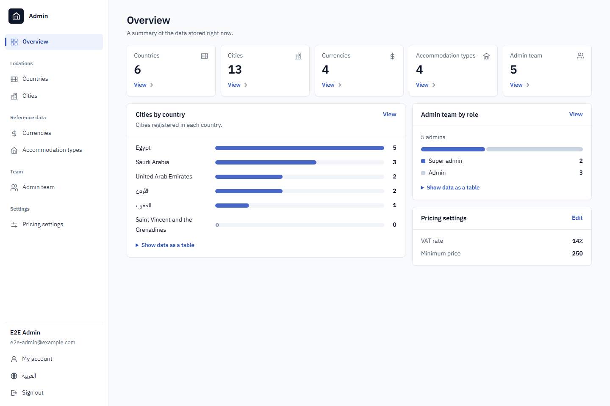
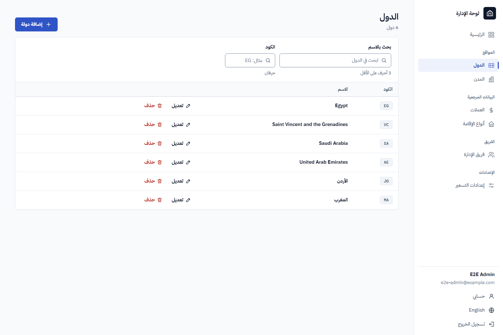
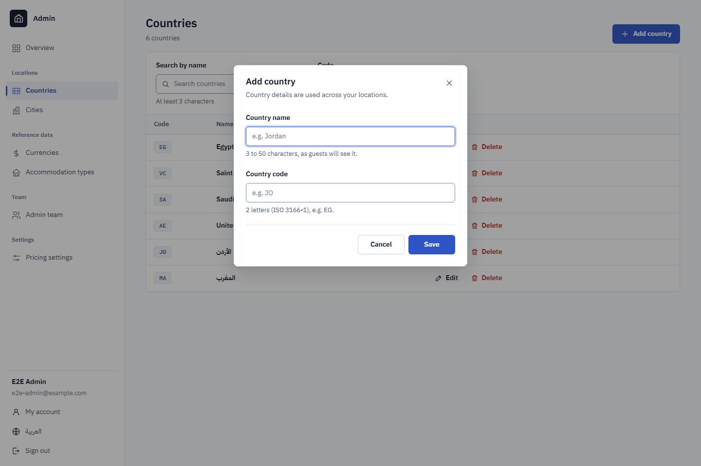

# airbnb-clone-web

Bilingual (Arabic/English) admin panel for a stays-booking platform, built with Next.js and a backend-for-frontend that keeps API tokens out of the browser.

This repository is a pnpm monorepo containing the admin front end and the typed API contract it consumes. It demonstrates a security-first session design (sealed HttpOnly cookie, coordinated refresh-token rotation, CSRF checks, an operation allowlist), contract-driven typing and validation generated from OpenAPI, full RTL support, and an end-to-end suite that runs against a real, isolated backend rather than mocks.

Companion backend (NestJS + MongoDB): [muhamed-mustafa/airbnb-clone-api](https://github.com/muhamed-mustafa/airbnb-clone-api)







Screenshots are captured by the Playwright suite from a production build, using synthetic data.

## Features

- **Admin sign-in and sign-out.** Only accounts whose token carries the `admin` role are accepted. Sign-out ends the session in the current browser; the UI states this explicitly because the backend has no logout endpoint yet.
- **Overview.** Exact totals per resource, cities per country, admins by role, and the stored pricing settings. Every figure comes from a real API response; a failed count shows a retry, never a zero.
- **Countries and cities.** Paginated lists with debounced search, filters kept in the URL, create/edit/delete dialogs, and a searchable country picker for cities.
- **Currencies and accommodation types.** The same list and form workflow (`/catalog/currencies`, `/catalog/unit-categories`).
- **Pricing settings.** VAT rate and minimum price. Only changed fields are sent, and Arabic-Indic digits and decimal separators are accepted.
- **Admin team.** Read-only list with name, email and role filters, plus a detail page. The API exposes no write operations for admin accounts.
- **My account.** Read-only profile of the signed-in admin.
- **Arabic and English.** Arabic is the default; direction (RTL/LTR), messages, validation text and error text all follow the selected language.
- **Responsive layout.** Tables on wide screens, row lists and bottom-sheet dialogs on phones, and a drawer for navigation.
- **Accessibility.** Skip link, focus returned to the control that opened a dialog, `prefers-reduced-motion` respected, and automated axe checks against WCAG 2.2 A/AA.

## Architecture

```text
apps/admin
  src/app/(shell)/        authenticated pages: overview, locations, catalog, team, settings, account
  src/app/login/          sign-in page
  src/app/bff/session/    POST sign in, GET session status, DELETE sign out
  src/app/bff/api/[...path]/   allowlisted proxy to the backend
  src/proxy.ts            page guard: redirects visitors without a session to /login
  src/server/             session sealing, refresh coordinator, CSRF, allowlist, backend client
  src/features/           one folder per screen: api hooks, schema, screen, dialogs
  src/ui/                 shared components (dialog, field, button, pagination, toast, ...)
  src/i18n/, messages/    locale resolution and ar/en message catalogs
  e2e/                    Playwright specs and the isolated-backend setup
packages/api-contract
  openapi/openapi.json    committed snapshot merged from the backend's OpenAPI documents
  src/generated/          generated TypeScript types and Zod schemas
  src/errors.ts           error normalizer shared by the BFF and the browser
docs/
  session-error-contract.md    the session and error contract (written in Arabic)
```

**Backend-for-frontend.** The browser never calls the NestJS API and never sees a token. Route handlers under `/bff/*` hold the access and refresh tokens and call the backend server-side. This removes tokens from JavaScript entirely, makes CORS unnecessary, and gives one place to enforce the rules below.

**Session sealing.** Tokens are stored in a single cookie encrypted with `iron-session`: `HttpOnly`, `SameSite=Lax`, `Secure` and the `__Host-` prefix in production. JWT claims are read only to schedule refreshes and label the session; authorization is always decided by the backend.

**CSRF and origin checks.** Every state-changing BFF request must present an `Origin` equal to the configured `APP_ORIGIN`, or, when `Origin` is absent, `Sec-Fetch-Site: same-origin`. Requests with a body must be `application/json`. The comparison value comes from configuration, never from `Host` or `X-Forwarded-*` headers.

**Token refresh.** The BFF refreshes shortly before the access token expires, and once more after a 401 from the backend's JWT guard, then replays the request a single time. A per-session coordinator ensures one rotation at a time, hands the new tokens to requests that still carry the previous cookie for 30 seconds, and blocks cookie writes for a session that was signed out mid-flight. Only a confirmed 401 on refresh ends the session; network errors, timeouts, 429 and 5xx return a retryable error and keep the user signed in. Coordinator state is in memory, which is correct for a single server instance; running several instances would need a shared store behind the same interface.

**Operation allowlist.** The proxy forwards only declared resource/method pairs and only declared query parameters; everything else is a 404 from the BFF. Admin account responses are additionally projected to `id`, `name`, `email` and `isSuperAdmin`, and a response that does not match that shape fails closed with a 502.

**Generated API contract.** `pnpm api:sync` merges the backend's three OpenAPI documents into one snapshot and regenerates types and Zod Mini schemas with `@hey-api/openapi-ts`. Forms extend the generated schemas instead of restating limits, and a golden-file test pins the validation behaviour of every form schema.

**Error normalization.** The backend answers errors in several shapes. `normalizeBackendError` converts all of them into one `AppError` (kind, form errors, field errors, request id). The UI resolves text from its own catalog by error code, falls back to backend text for 4xx only, and never displays server text for 5xx. Each request carries a request id, forwarded to the backend and shown in the UI for failures the user cannot fix themselves.

**i18n and RTL.** `next-intl` with a cookie-based locale and no locale segment in the URL. The root layout sets `lang` and `dir`; styles rely on logical properties and direction variants, so one stylesheet serves both directions. The locale is also forwarded to the backend as `Accept-Language`.

**State and data fetching.** TanStack Query holds all server state; there is no global client store. List filters and paging live in the URL. Reads retry once on transient failures; writes are never retried and never optimistic, because a timed-out write may have been applied, so lists are invalidated on settle instead. Form dialogs (React Hook Form + Zod) are loaded on demand.

## Tech Stack

| Area            | Choice                                                         |
| --------------- | -------------------------------------------------------------- |
| Framework       | Next.js 16.3 (App Router), React 19.3                          |
| Language        | TypeScript 6.0, strict with `noUncheckedIndexedAccess`         |
| Styling         | Tailwind CSS 4.3 with design tokens, Radix UI primitives 1.6   |
| Data            | TanStack Query 5.104                                           |
| Forms           | React Hook Form 7.89, Zod 4.6 (Zod Mini)                       |
| Session         | iron-session 9.0                                               |
| i18n            | next-intl 4.14                                                 |
| Contract        | @hey-api/openapi-ts 0.99                                       |
| Tests           | Vitest 5.0, Playwright 1.63, @axe-core/playwright 4.13         |
| Tooling         | pnpm 11.21 workspaces, ESLint 9, Prettier 3.9, Node 24         |

## Getting Started

Requirements:

- Node 24 (see `.nvmrc`) and pnpm 11
- The backend running on `http://localhost:3000`, with its MongoDB replica set (`docker compose up -d` in `airbnb-clone-api`)

```bash
pnpm install
cp apps/admin/.env.example apps/admin/.env.local   # then set SESSION_SECRET (32+ random characters)
pnpm dev:admin                                      # http://localhost:4100
```

Sign in with an admin account that exists in the backend.

Other scripts, run from the repository root:

```bash
pnpm build          # production build of every package
pnpm typecheck
pnpm lint
pnpm format:check
pnpm api:sync       # regenerate the API contract from a backend running on http://localhost:3000
```

The merged OpenAPI snapshot is committed, so builds never need a running backend.

## Environment Variables

Read by the admin server (`apps/admin/.env.local`):

| Variable               | Required | Meaning                                                                    |
| ---------------------- | -------- | -------------------------------------------------------------------------- |
| `API_BASE_URL`         | yes      | Base URL of the NestJS API. Only the BFF calls it.                         |
| `APP_ORIGIN`           | yes      | This app's own origin. CSRF checks compare the `Origin` header against it. |
| `SESSION_SECRET`       | yes      | At least 32 characters. Seals the session cookie.                          |
| `REFRESH_SKEW_SECONDS` | no       | Refresh this many seconds before the access token expires. Default 30.     |
| `BACKEND_TIMEOUT_MS`   | no       | Timeout for one backend call, in milliseconds. Default 10000.              |

Read by tooling only:

| Variable            | Meaning                                                                               |
| ------------------- | ------------------------------------------------------------------------------------- |
| `API_DOCS_BASE_URL` | Backend URL used by `pnpm api:sync`. Defaults to `http://localhost:3000`.             |
| `E2E_BACKEND_REPO`  | Path to a local clone of the backend. Defaults to `../airbnb-clone-api`.              |
| `E2E_BACKEND_REF`   | Backend commit the end-to-end suite builds and runs. Defaults to a pinned commit.     |
| `E2E_MONGO_URI`     | MongoDB URI for the end-to-end database. The database name must be `airbnb-clone-e2e`. |
| `E2E_ADMIN_PORT`    | Port for the admin under test. Default 4100.                                          |
| `E2E_SKIP_BUILD`    | Reuse an existing production build instead of rebuilding.                             |

## Testing

```bash
pnpm test    # unit tests (Vitest)
pnpm e2e     # Playwright, desktop and mobile projects
```

**Unit tests** cover the server-side core: the allowlist and response projection, CSRF verdicts, the refresh coordinator (concurrent refreshes, sign-out during a refresh, `Retry-After`), the session call flow, backend response classification and the error normalizer. On the client side they cover form schemas, list query handling, safe redirect paths, navigation detection and the golden-file validation check.

**End-to-end tests** run the production build of the admin against a real backend. The global setup:

1. exports a pinned backend commit with `git archive` from a local clone into `.cache/`, without a `.env` file and without writing anything to that clone, and builds it;
2. starts it on port 3100 with secrets and an admin account generated for the run, and short-lived access tokens so every run exercises the refresh path;
3. drops the `airbnb-clone-e2e` database first, only after confirming on the live connection that the database name is exactly that.

The specs cover authentication and redirects, concurrent refresh and sign-in elsewhere, sign-out races, CSRF rejection and the allowlist, create/edit/delete flows for each resource, the read-only admin team, filter debounce and navigation races, responsive layout, reduced motion, and axe accessibility audits.

Prerequisites for `pnpm e2e`: a clone of the backend next to this repository with its dependencies installed, MongoDB running as replica set `rs0` on `localhost:27017`, and `git` and `tar` on the `PATH`. One helper suite in the unit tests also resolves commits in that clone, so `pnpm test` expects it as well.

There is no CI workflow in the repository yet; all checks are run locally.

## Project Status / Roadmap

This repository currently contains the admin panel only.

Implemented: sign-in and session handling, overview, countries, cities, currencies, accommodation types, pricing settings, the read-only admin team and the account page.

Not implemented:

- **Customer-facing site.** Not started. It is planned as a separate repository.
- **Listings (units), file uploads and user management.** The backend has added endpoints for these since the committed contract snapshot was taken; the admin has no screens for them and the snapshot needs a re-sync first.
- **Managing admin accounts and editing the profile.** Blocked on the API, which only exposes read operations for admins.
- **Server-side logout.** Sign-out is local to the browser until the backend can revoke a session.
- **Multi-instance deployment.** Refresh coordination is in memory and needs a shared store before running more than one server instance.
- **Continuous integration and a deployed demo.**

## Author

[Muhammed Mustafa](https://github.com/muhamed-mustafa)
